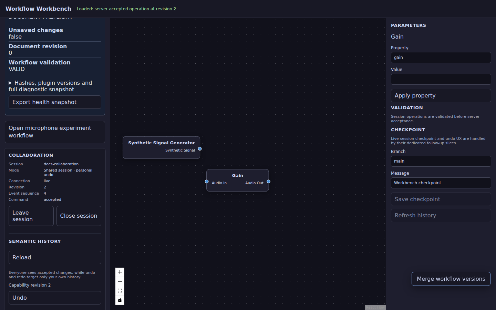
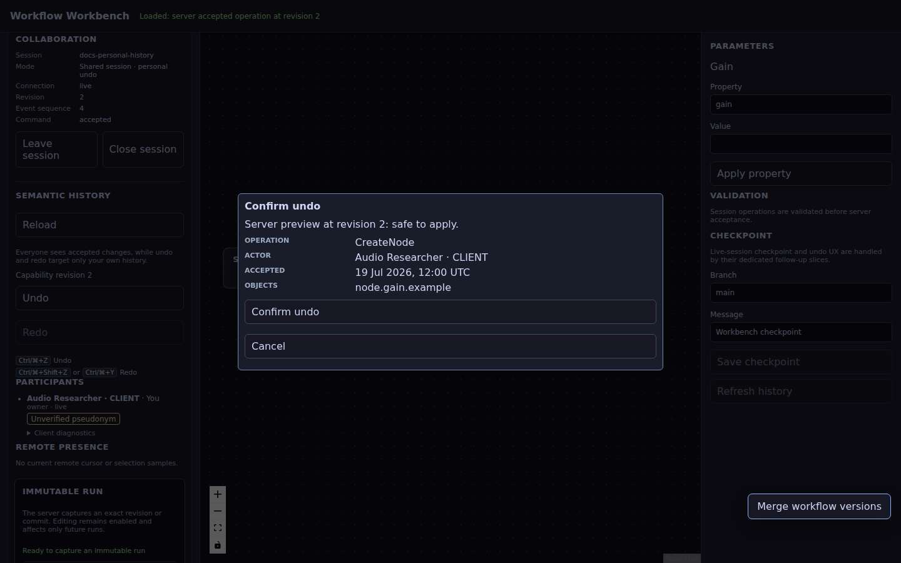
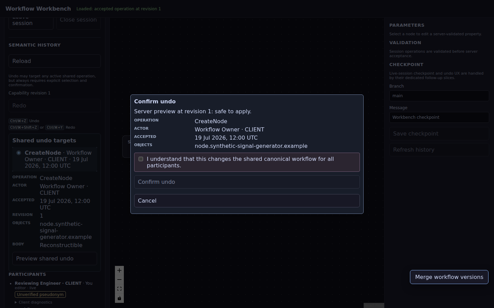

# Collaborative workflow design

The web workbench lets multiple browser actors edit one canonical audio-processing workflow. React Flow renders the graph and translates gestures into semantic commands; the server owns accepted state, revision ordering, durable history and undo eligibility.



## First shared workflow in two browsers

Build the packaged application using [Getting started](../getting-started.md), then start one server
from the repository root:

```bash
java -jar audio-app/target/audio-app-0.1.0-SNAPSHOT-workbench.jar
```

Open [http://localhost:8080/workbench](http://localhost:8080/workbench) in two separate browser
profiles or browsers, called A and B below. Both must reach the same server; on different computers
use that server's reachable address instead of each computer's `localhost`. Separate profiles make
the two clients easy to distinguish. Fresh tabs also support independent clients; the
[identity guide](../collaboration-identity.md) explains duplicated tabs and cookie lifetime.

The default memory mode is sufficient for this exercise while the server stays running. Choose
[Hibernate persistence](../workbench-hibernate-persistence.md) before starting the exercise if session
state must survive a server restart. Filesystem checkpoint storage does not make collaboration
identities or sessions durable.

1. In browser A, find **Collaboration**. Enter an unused **Session id**, such as
   `shared-audio-review`, and a **Workflow name**. Set **Mode** to **Shared session · personal undo**
   **before** creating the session; the mode cannot change afterwards.
2. Optionally enter `Alice` under **Display name** and select **Save display name**. A chosen display
   name is an unverified pseudonym, unless the deployment separately supplies authenticated identity.
   If this client already has an issued identity, the name is read-only. To choose another, use
   **Start a new client identity** while outside a session; that does not inherit old ownership or undo.
3. Select **Create session**. Wait until **Connection** reads `live`. The new session has an empty
   graph, revision 0 and the creating client as owner. The orientation graph is not copied into it.
4. In browser B, optionally save a different display name, enter the **same Session id**, then select
   **Join session**. Do not create it a second time. The owner's chosen mode applies to the joined
   session. Wait for `live` and confirm that both clients appear under **Participants**, with one row
   marked **You** in each browser.
5. In browser A's **Node palette**, select **Synthetic Signal Generator**. Wait for the node and the
   new semantic revision in both browsers. In browser B, add **Gain** and again confirm that both
   canvases converge. Selecting a node can appear as remote presence without changing the revision.
6. In browser B, select **Undo** under **Semantic history**. Review the Gain creation, actor, time and
   affected object in the fresh server preview, then select **Confirm undo** when it is safe. The Gain
   disappears in both browsers and the revision advances. Select **Redo**, review, then **Confirm redo**
   to restore it. Browser A's personal Undo targets A's own operation, not B's creation.
7. Reload browser B. With its cookie and tab identity intact, it should rejoin the remembered session,
   reach `live` and show the same graph, semantic revision and history capabilities. Continue with the
   runnable example below, or keep the session open for more edits.

## Connect, configure and run the shared graph

Only the deterministic **Synthetic Signal Generator → Gain** path is currently executable by the
production workflow backend. Other catalog entries can describe workflows but are not automatically
executable. The run below is offline computation and does not acquire a microphone.

1. With the two nodes above present, drag from the generator's right-hand **Synthetic Signal** output
   handle (`signal-out`) to Gain's left-hand **Audio In** input (`audio-in`). Confirm the connection
   appears in both browsers.
2. Select the generator. In the right-hand **Parameters** panel, enter each **Property** and **Value**
   below and select **Apply property** after each one. Wait for acceptance before the next edit. Then
   select Gain and apply its property. New palette nodes do not supply these execution parameters
   automatically; use `gain.factor`, not the generic input's initial `gain` text.

   |            Node            |        Property         | Value  |
   |----------------------------|-------------------------|--------|
   | Synthetic Signal Generator | `signal.waveform`       | `sine` |
   | Synthetic Signal Generator | `signal.frequency-hz`   | `1000` |
   | Synthetic Signal Generator | `signal.phase-radians`  | `0`    |
   | Synthetic Signal Generator | `signal.amplitude`      | `0.5`  |
   | Synthetic Signal Generator | `signal.sample-rate-hz` | `8000` |
   | Synthetic Signal Generator | `signal.channels`       | `1`    |
   | Synthetic Signal Generator | `signal.frame-count`    | `8`    |
   | Gain                       | `gain.factor`           | `2`    |

3. Find **Immutable run** below the collaboration controls. Confirm **Current session** shows
   the intended session and revision. Wait for **Selected workflow readiness** to report a successful
   preflight for that exact graph. Missing parameters, disconnected required ports and unsupported
   node types keep **Run current revision** disabled; correct the listed node-specific diagnostics.

4. Select **Run current revision** once. Review its captured revision, fingerprint, backend mode,
   progress and final state. The configured example should report `COMPUTATION` and a completed
   result with per-node statuses and audio evidence. Later graph edits affect only future runs.

5. Select **Export server result JSON** to retain the result, fingerprint and output evidence before
   stopping the server. **Prepare another run** resets the run panel for another explicit start.
   **Cancel run** is available while a run is active, but this eight-frame example may finish before
   cancellation can be requested. An uncertain start offers **Retry same start command**.

The [deterministic example](../architecture/deterministic-audio-workflow-example.md) gives the expected
sample sequence. [Backend parameters and limits](../architecture/deterministic-audio-workflow-backend.md)
and [run lifecycle](../architecture/workflow-run-lifecycle.md) describe the computation contract.
Runs and completed run records are process-local, including in Hibernate mode. The run panel does
not recover a durable job list after restart; retain the exported result when it matters.

### Run a stored checkpoint

With checkpoint storage configured, the same **Immutable run** panel can execute an existing stored
graph. Enter its **History branch**, select **Refresh run sources**, then choose an exact
**Historical commit**. Review the workflow ID and commit ID, wait for **Stored commit readiness**, and
select **Run selected commit** when enabled. Inspect and export the result as above. This does not
replace the current session or load the commit onto its canvas.

The stored graph needs the same supported topology and explicit parameters. The empty minimal
document used in the document/history tutorial is suitable for interchange, but is not this executable
graph. An empty history list means the selected branch has no checkpoints; **Stored commit history
unavailable** means the history endpoint cannot supply them. Neither condition prevents running a
valid live-session graph.

## Try shared undo

To try the other undo policy, leave the current session in both browsers, use a new session ID and
choose **Shared session · shared undo** before creation in A. Join browser B to that session. Have A
add a node, then in B:

1. Select the corresponding radio row under **Shared undo targets**. Inspect the operation and actor;
   use **Load older operations** if needed.
2. Select **Preview shared undo**. The server computes whether this particular inverse is safe at
   the current revision.
3. Review the affected objects and acknowledge **I understand that this changes the shared canonical
   workflow for all participants**. Select **Confirm undo** only while the preview is safe.
4. Check that the change reaches A. B, which accepted the undo, can select **Redo**, review the new
   preview and confirm to reapply it. A new audited operation is added for each action.

If later edits block the inverse, the preview lists the blockers and confirmation stays disabled.
Coordinate the affected changes, reload history and request a new preview; a cached history row or
an old preview cannot authorize an unsafe inverse.

## Leave, return and preserve work

**Leave session** removes only this client's membership and presence. The server retains the session
for rejoining; the same client can enter its ID and select **Join session** again. Closing or changing
browser storage can lose that client's selector or credential, so retain the same tab and cookies
when preserving personal attribution. Credentials expire 30 days after issue; a new client identity
does not recover another client's ownership or personal undo.

The owner can use **Close session** to end it. In the browser, rejoin first if the owner has left and
needs this control. Other participants cannot close it. An empty retained session does not block a
standalone document import or history restore, but joined participants can.

Three persistence actions have different scopes:

|                        Action                        |                          What it preserves                           |                         What it does not do                         |
|------------------------------------------------------|----------------------------------------------------------------------|---------------------------------------------------------------------|
| Accepted session edits in Hibernate mode             | Recoverable session graph, semantic history and identity attribution | Create a Git checkpoint for each edit or export a portable document |
| **Save checkpoint** outside collaboration            | A version of the separate standalone editor graph                    | Save the session just left; leaving reloads the standalone graph    |
| **Save current document** in **Experiment document** | The complete standalone portable document workspace                  | Export the visible live-session graph or its edits                  |

There is currently no UI transfer from a live collaboration graph to a portable document or stored
checkpoint, and creating a session does not seed it from either one. Use the
[desktop document workflow](portable-experiment-documents.md#desktop-open-edit-save-and-reopen) for
an editable `.audioexp` round trip, and [version history](workflow-history-search.md) for checkpoints
that already belong to the standalone editor. **Run selected commit** can execute a compatible
stored graph without turning it into the live session.

## When a step is blocked

|                              Symptom                               |                                                       Next step                                                       |
|--------------------------------------------------------------------|-----------------------------------------------------------------------------------------------------------------------|
| Create/join disabled after typing a name                           | Select **Save display name** first.                                                                                   |
| Session ID already exists                                          | Join that session, or choose another ID before creating a different session.                                          |
| Private workspace cannot be joined                                 | Use its owner client, or create a shared session with the intended mode.                                              |
| Connection is reconnecting; palette or history controls are paused | Wait for `live`; the client reloads canonical state and capabilities before editing resumes.                          |
| Edit/undo reports a stale revision                                 | Review the refreshed graph and obtain a new preview before submitting the intended action again.                      |
| Command result is uncertain                                        | Reload history or use **Retry same command**; retain the shown command ID.                                            |
| Identity expired or no longer matches the signed-in account        | Follow the identity error and start a new client identity; previous ownership is not automatically transferred.       |
| Run disabled                                                       | Read **Selected workflow readiness**, correct graph/parameter errors, and wait for preflight of the current revision. |
| History search is absent                                           | Configure Hibernate persistence; the indexed drawer is not available in memory/filesystem modes.                      |

## What collaboration changes

Without an active session, the initial workflow is a read-only example.

After a session is created or joined:

- node, edge and property changes become typed semantic operations;
- each command carries the actor and expected semantic revision;
- the server validates and appends accepted operations;
- ordered SSE delivers accepted projections and presence;
- stale commands are rejected without an optimistic graph residue;
- a reconnect or full page reload obtains canonical state from the server.

## Choose an undo model deliberately

The collaboration mode is immutable for a session.

### Private workspace

One actor owns the workspace. Undo and redo use that actor's durable semantic history.

### Shared session with personal undo

All participants see accepted changes. An actor may undo their own current operation when later semantic changes do not conflict with it.

The server does not silently skip a blocked operation. It reports the later operations and semantic object identifiers that prevent a safe inverse.

### Shared session with shared undo

Participants may inspect active operations from the shared durable history. No operation is selected automatically.

A shared undo requires:

1. explicit target selection;
2. a fresh server preview at the current revision;
3. review of actor, time, operation and affected objects;
4. acknowledgement that all participants' canonical graph will change;
5. final server revalidation.

## Personal undo preview



The preview is generated immediately before execution. It describes the exact target and whether the inverse is currently safe. Confirmation is disabled when later operations conflict with the target.

Undo is a new audited operation. The original operation remains in history.

## Shared undo preview



The target browser shows durable active operations with actor, timestamp, revision, affected objects and reconstructibility. Shared confirmation cannot be bypassed by a keyboard shortcut.

## Redo and repeated history actions

Redo targets an accepted undo operation owned by the requesting actor. It is rejected when the undo has already been reapplied, later semantic state conflicts or the expected revision is stale.

Repeated undo/redo cycles create new operation identities. They never remove earlier audit records.

## Reload and reconnect

The browser stores its actor identity and active session id in per-tab session storage when available.

A full reload:

1. reloads the ordinary orientation page;
2. rejoins the remembered session;
3. obtains session metadata and canonical projection;
4. opens ordered SSE from the accepted sequence;
5. reloads durable history and actor capabilities.

The legacy orientation projection is not allowed to overwrite an active session restored later in the same startup sequence.

When the SSE request fails, the client reconnects from its accepted sequence. Missing operations are replayed or a canonical snapshot is applied. The browser does not synthesize missing graph edits locally.

## Ambiguous transport results

A command may reach the server even if its HTTP response is lost. History commands therefore use a stable client-generated `commandId`.

After an ambiguous failure:

- the exact pending envelope remains visible;
- canonical session and durable history are reloaded;
- acceptance is proven only when durable history contains that command id;
- otherwise the user may retry the same envelope;
- a replacement command id is never generated for the uncertain submission.

## Presence is not workflow state

Selection, cursor or viewport information is actor-scoped presence. It helps collaborators understand each other's focus but does not enter:

- the canonical workflow DSL;
- semantic revision history;
- undo/redo eligibility;
- Git checkpoints;
- reproducibility input.

Remote presence expires independently of participant membership and workflow history.

## Keyboard behavior

- `Ctrl/⌘+Z` opens the same undo preview as the visible control.
- `Ctrl/⌘+Shift+Z` and `Ctrl/⌘+Y` open the redo preview.
- Shared undo still requires a selected target and acknowledgement.
- Shortcuts are ignored while focus is in an editable form control.

## Executable evidence

The dedicated two-browser suite runs the production-packaged application with two isolated Chromium contexts. It proves:

- live cross-browser projection convergence;
- remote presence outside canonical workflow state;
- stale-revision rejection;
- controlled SSE interruption and catch-up;
- full reload and session restore;
- personal undo and redo;
- shared target selection, acknowledgement, undo and redo.

The suite uses no fixed-delay sleeps. It waits only for observable revisions, connection states, HTTP responses and DOM visibility.

See [Two-browser collaboration end-to-end tests](../collaboration-e2e.md).

## Current boundaries

- The browser is not a semantic workflow engine.
- Yjs, when present, is not authoritative for nodes, edges or properties.
- A cached history row is descriptive; only a fresh preview and command authorize an inverse.
- Live-session checkpoint behavior remains separate from semantic editing.
- Full durable process-restart E2E coverage is implemented; see
  [durable restart evidence](../durable-restart-e2e.md). It verifies session/outbox and checkpoint
  recovery separately and does not imply automatic live-session checkpoints or durable run jobs.

For implementation details, see:

- [React Flow session client](../architecture/react-flow-session-client.md)
- [Durable semantic undo and redo](../architecture/semantic-undo-redo.md)
- [Hibernate-backed persistence](../workbench-hibernate-persistence.md)

## Participant identity

Participants now use [server-bound identities](../collaboration-identity.md). Rows distinguish
verified accounts from anonymous or self-asserted pseudonyms, show role and connection health, and
keep internal actor identifiers in diagnostics. Account handles are hidden unless the server privacy
policy permits disclosure.
