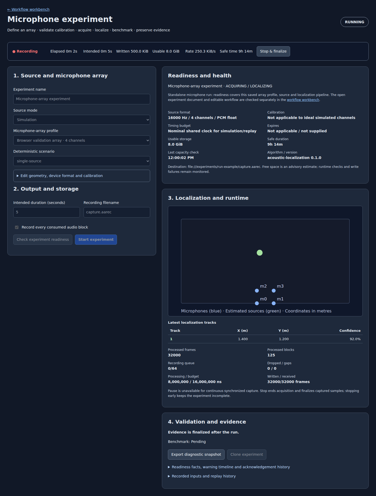
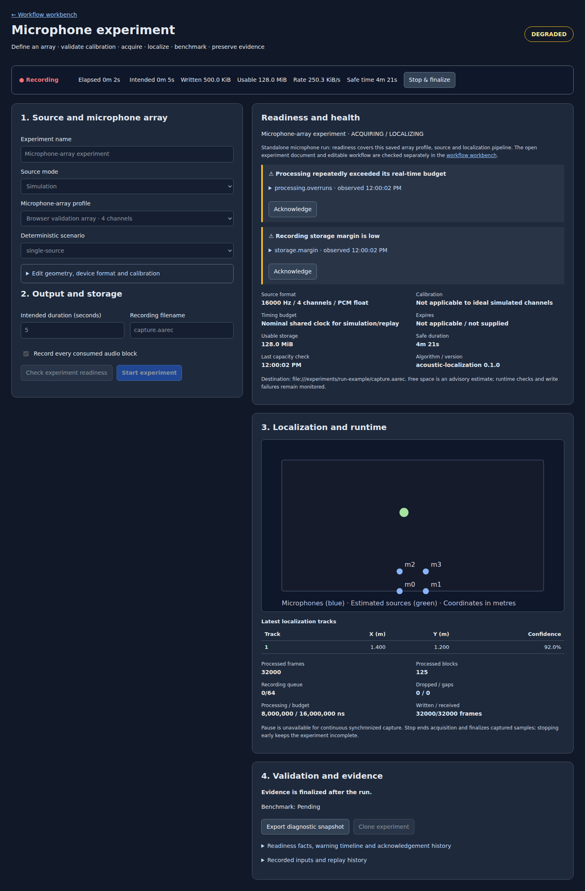
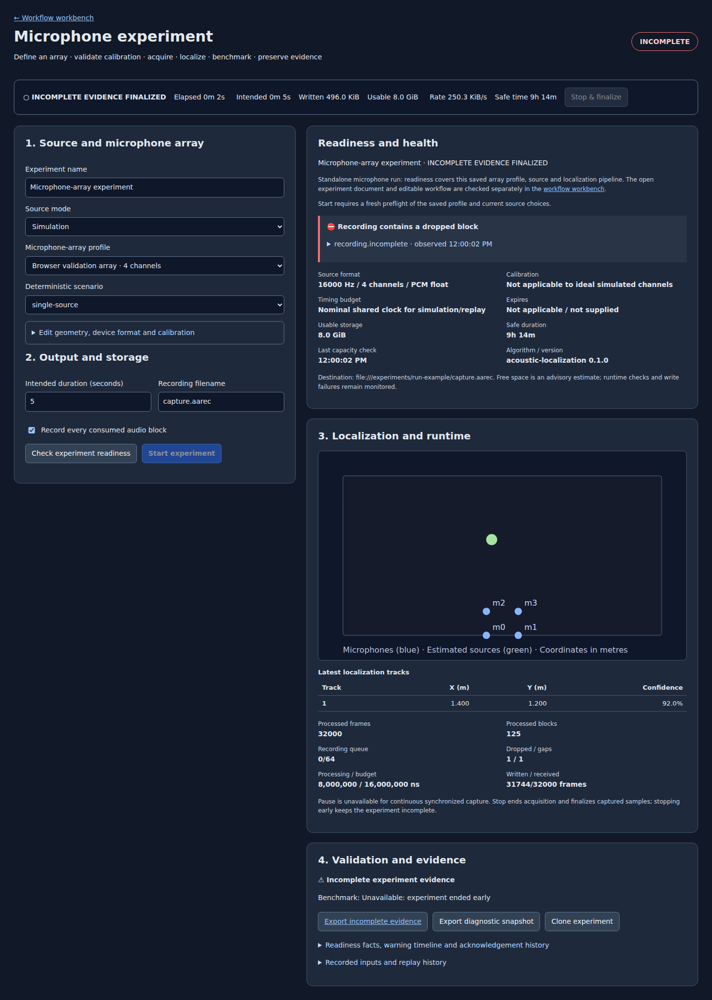

# Experiment readiness and runtime health

The workflow workbench and microphone experiment views use `ExperimentHealthSnapshot` and
`ExperimentHealthAggregator`. The desktop shows the same document projection in its persistent
**Document readiness** strip, with expandable details and a copyable diagnostic snapshot.

The overall state is always accompanied by text. Findings preserve their code, severity, component
or document pointer, source timestamp, technical explanation and remedy. A blocking condition cannot
be acknowledged into a ready state. Runtime microphone warnings remain latched after a subsequent
healthy frame; acknowledgement and recurrence remain in significant event history.
The browser's per-alert action and Swing's **Acknowledge alert…** action use the same persisted
acknowledgement path. Neither offers an acknowledgement for a true blocker. The desktop records an
explicit unattributed local operator, and final evidence writes run away from Swing's event thread.

## Readiness belongs to an exact scope

|              Scope               |                                                                                                  Inputs and correlation                                                                                                  |                             What the result establishes                             |
|----------------------------------|--------------------------------------------------------------------------------------------------------------------------------------------------------------------------------------------------------------------------|-------------------------------------------------------------------------------------|
| Experiment document              | One retained preview, document-session revision, dirty state and canonical hash; the actual editor graph, its canonical DSL hash and structural validation; installed/required plugin sections and migration diagnostics | Whether the current document is compatible and which resources remain unresolved    |
| Immutable workflow               | An authorized session graph captured atomically with membership and semantic revision, or an exact stored commit; the same source capture, execution plan and backend capability checks used by Start                    | Whether that exact graph can run on the configured workflow executor                |
| Standalone microphone experiment | Saved microphone profile and configuration fingerprint; selected simulation, managed replay or real host device; measured calibration, geometry, recorder and storage observations                                       | Whether that source/profile/configuration can run through the localization pipeline |

The document card shows name/path, format/version, dirty state, canonical hash, document revision,
workflow hash, required and installed plugin versions, migrations, assets and requested output
formats. Its hash is labelled as the validated snapshot when unsaved edits exist. A workflow hash
mismatch is a blocker, so a changed graph cannot borrow an older document's readiness.

The Swing session retains only previews validated by `ExperimentDocumentCodec`, including structural
`WorkflowValidator` checks of the exact embedded graph. An invalid workflow draft remains dirty and
cannot replace that retained preview. The desktop health card labels the hash as a validated snapshot
while drafts differ; the web workspace additionally validates its independently captured editor graph.

Local bindings in an import-preview form are assessments of that candidate. They are not retained
execution bindings for a later document revision. The current document card therefore reports
`UNVERIFIED_FOR_CURRENT_SNAPSHOT` and the concrete missing asset/device/output requirements until
the current execution scope actually owns correlated bindings. Documents with no local requirements
report `NONE_REQUIRED`. This check supplies no filesystem paths and does not hash local files during
status refresh.

The workflow executor captures the graph and produces its own computation result. Portable document
profiles, external assets and requested output files are shown in the document card; they are not
silently supplied to a graph-only execution. This scope appears in the workflow readiness and result
facts. The standalone microphone workflow similarly marks document/workflow state as not applicable,
because it consumes the saved microphone profile and source settings instead.

## Run controls and authorization

**Run current revision** and **Run selected commit** remain disabled until the displayed source has a
successful preflight with the canonical workflow fingerprint. An older revision or a different commit
cannot authorize the button. Failed status requests clear readiness, and an independent clock marks
stalled observations stale after five seconds while retaining their last values for inspection.
Start sends `expectedFingerprint` and performs the server-side capture and capability check again.
A reused session ID/revision with different content produces `SOURCE_FINGERPRINT_MISMATCH` (HTTP 409)
before dispatch. Idempotent retries compare with the already captured run instead of reading a new
source; the original run stays accessible through its retained grant after session closure. Legacy
API callers may omit the optional fingerprint field.

`GET /workflow/experiment-health` reports the local document. Selecting `sessionId` and `revision`
requires the server-issued identity credential and current session membership. The graph and its
membership check are captured under the same session lock, so closing and recreating an identifier
cannot substitute another private graph. A `commitId` selects stored history. A `runId` uses the same
retained owner/member access rules as the existing run/result endpoints.

Owner and operator facts use the identity policy's public projection, including provenance. The
dashboard does not serialize private account subjects or raw authenticated handles. Standalone
microphone acknowledgements use an explicit unattributed or identity-withheld label.
Active and final workflow health snapshots, including their JSON export, retain the original run
creator and session owner from the authorized run grant. A later observer does not replace those
actors. Stored-commit runs without recorded attribution say so explicitly.

## Runtime and evidence

Workflow execution states are projected into the shared lifecycle: queued/running work is `RUNNING`,
cancellation requested is `STOPPING`, cancellation is `INCOMPLETE`, and failure is `FAILED`. A completed
computation becomes complete scoped evidence only when the terminal result, completed node statuses
and output evidence inventory are present. Lifecycle-only simulation is labelled as such and does
not become complete audio evidence. Generated artifact keys, their hashes, the actual output digest,
backend version, captured source hash and revision/commit remain available in the diagnostic details.

Microphone runtime includes the persistent red recording indicator, elapsed/intended duration,
processed and written frames, queue/drop/gap counts, storage margins, signal quality, synchronization,
processing budget and plugin versions. Its complete/incomplete decision also inspects the finalized
recording, checks cancellation and required artifacts, and persists the actual manifest and hash
inventory before enabling evidence export. See [microphone experiments](microphone-experiments.md)
and [recording and replay](recording-and-replay.md).
Acknowledgements made after finalization rewrite the persisted health report and checksum inventory
under the same evidence lock as ZIP export, so downloaded history matches the acknowledged state.
The recording file SHA-256 includes the footer and matches the artifact inventory; the separately
named verified-content SHA-256 covers only the bytes protected by the recording format's footer.

### Microphone runtime examples

These three views use fixed typed health and recording snapshots rendered by the packaged browser
application. Capacity, throughput, timing, destination, warning timestamps and track values are
example data and are shown without masks. They document state presentation and controls; the actual
preflight and completed-simulation captures are in the
[microphone experiment guide](microphone-experiments.md).

**Recording — fixed runtime fixture.** The persistent strip and runtime card show recording progress,
queue occupancy, throughput and the safe-duration estimate. Setup and Start are disabled while
**Stop & finalize** remains available.

**Degraded — fixed runtime fixture.** Low storage margin and repeated processing-budget overruns are
visible together while recording continues. The capacity and remaining safe duration stay readable
alongside the warning acknowledgements and stop action.

**Incomplete — fixed runtime fixture.** A dropped block leaves a gap in the finalized recording.
The state and export action both say **Incomplete**, and Stop is disabled after finalization.

## Verification and screenshot coverage

Behavior tests cover every shared lifecycle, explicit blockers, acknowledgement rules, latching,
freshness, exact source correlation, missing terminal outputs, privacy and authorization. The packaged
browser test runs an actual deterministic microphone simulation and downloads its ZIP evidence.
It also checks accessible control names, keyboard operation, visible focus, and computed text/focus
contrast. Existing workbench screenshots wait for observed document health and the exact selected
workflow revision before capture, with volatile observation times masked.
The six microphone images distinguish actual application runs from fixed examples:

|             Images              |                                               Data source                                                |                                                 Screenshot treatment                                                  |
|---------------------------------|----------------------------------------------------------------------------------------------------------|-----------------------------------------------------------------------------------------------------------------------|
| Ready, Blocked, Complete        | Actual packaged-app preflights and a completed simulation whose evidence ZIP is downloaded and inspected | Host-dependent capacity, throughput, runtime timing, paths, timestamps and recording digest are masked where present. |
| Recording, Degraded, Incomplete | Fixed typed runtime snapshots, independent of CI disk pressure and connected hardware                    | Example values remain unmasked so storage, rate, safe-duration and recording-health readings can be inspected.        |

The Complete image additionally hides a possible CI-load-dependent `processing.overruns` finding
only during screenshot rendering. The actual run, its persisted health report and downloaded evidence
retain their original data. The Degraded fixture documents the same warning visibly.

Physical array wiring, device permissions, timing drift, room accuracy and sustained acquisition still
require a real device and measured reference data. Software readiness reports the available evidence
and blockers for those conditions; simulation does not substitute for a hardware validation record.
