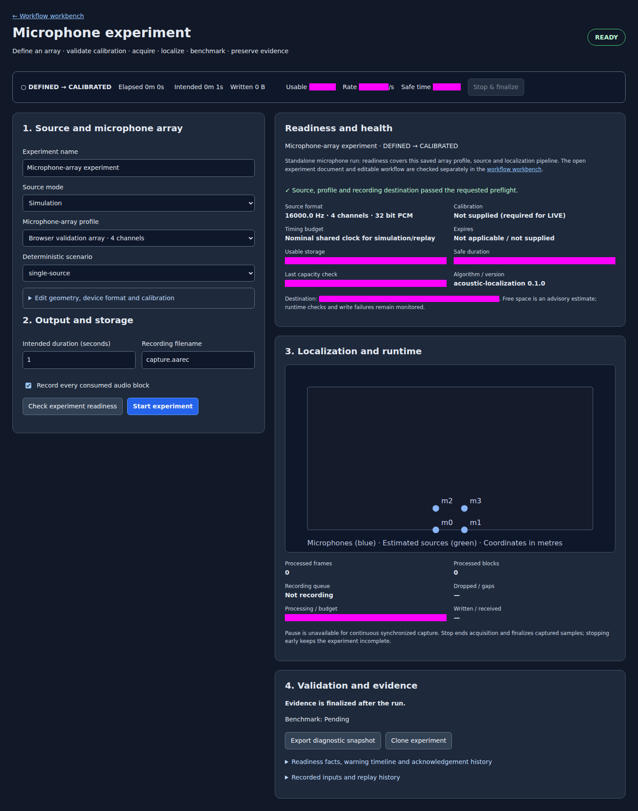
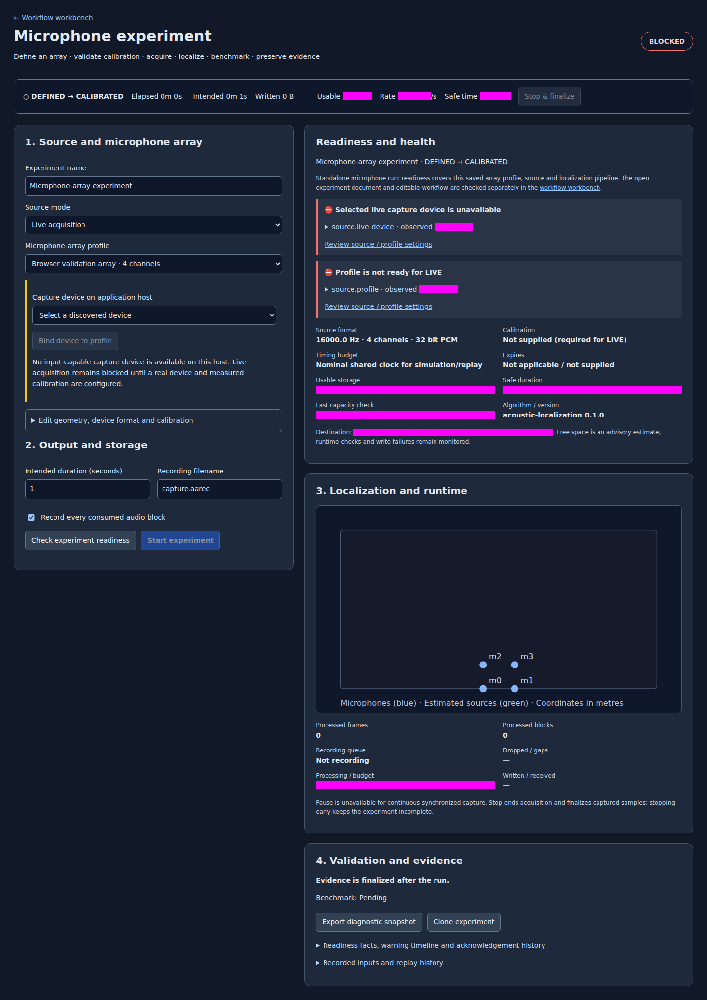
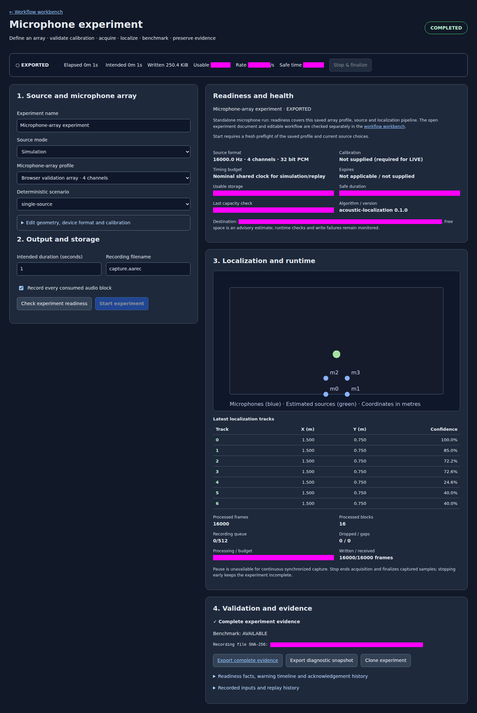

# Microphone experiments: setup, readiness, runtime and evidence

The maintained browser route is **`/workbench/experiment`**. Open it from **Open microphone experiment
workflow** in the workbench. The desktop entry point is **Experiment > Microphone-array workflow…**
in `ExperimentAudioAnalyseFrame`. Both views call `MicrophoneExperimentService` and display the same
immutable health model. They reuse the established acquisition, recorder and localization pipeline.

Start the browser or desktop host using [Getting started](../getting-started.md). The browser route
requires the running workbench application; opening a local HTML file does not provide acquisition
or recording services. Simulation requires no audio device. Live acquisition uses a device attached
to that application's host, including when the browser is on another computer.

The first simulation, live-setup and replay instructions below use **browser** labels. All screenshots
on this page show the browser. The [desktop workflow](#desktop-workflow) gives the Swing controls and
sequence; the source, recording and evidence requirements apply to both views.

## Complete a first simulation

1. Leave **Source mode** on **Simulation** and select **Rectangular four-microphone example**.
2. Choose **single-source**, set **Intended duration (seconds)** to **1**, and leave the recording
   filename as **capture.aarec**. Keep **Record every consumed audio block** enabled. This supplies a
   bounded first example: four channels at 16,000 Hz, with 16,000 frames per channel.
3. Open **Edit geometry, device format and calibration** if you need different microphone positions
   or channel counts. Positions are measured in metres; channels are contiguous from zero. Added
   channels require measured, distinct positions. To keep the example unchanged, give the edited
   profile a new **Profile identity** and **Profile name**, then choose **Validate & save profile**.
   Confirm that the new profile is selected before continuing. The untouched example can be used
   directly without an edit.
4. Choose **Check experiment readiness**. Review the source format, profile, calibration applicability,
   recording destination, usable storage, expected growth and safe-duration estimate.
5. **Start experiment** becomes available only after a ready preflight of the current saved choices.
   A true blocker must be resolved. A storage-margin warning requires explicit acknowledgement.
6. Let this short run finish automatically. Watch the persistent strip, readiness findings,
   microphone/track map, processing budget, recorder queue and dropped/gap counts. Successful input
   processing reports **16,000 processed frames**, **16,000 written / received frames** and no drops
   or gaps. Processing-budget warnings can still occur on a busy host; they are separate from missing
   samples. **Stop & finalize** ends acquisition early and retains an incomplete experiment. Pause
   is deliberately unavailable for continuous capture.
7. Use **Export complete evidence** or **Export incomplete evidence**, as labelled. The evidence ZIP
   contains the actual recording when requested, complete profile/configuration manifest,
   localization CSV, summary, health facts/history and `SHA256SUMS`. Simulation also includes the
   benchmark report against its known scenario. Live and replay never receive simulated ground truth.

For another run, change the name or use **Clone experiment**, select the desired inputs, and perform
a new readiness check. Clone copies the current run choices; it does not create an independent copy
of the saved microphone profile. Export the completed run before starting another one so its evidence
is already available outside the managed host directory.



**Ready — actual preflight.** The packaged application has checked the saved simulation profile and
current choices, and **Start experiment** is available. Masked regions cover host-dependent capacity,
throughput, timing and destination fields; they are not measured examples for a particular device.

## Desktop workflow

1. Open **Experiment > Microphone-array workflow…**. In **1. Source and profile**, select source mode
   **SIMULATION**, saved microphone profile **rectangular-example** and deterministic simulation
   **single-source**. The desktop profile selector shows saved IDs rather than browser display names.
2. Set **Intended duration (seconds)** to **1**, keep **capture.aarec** as the recording filename and
   leave **Record all consumed blocks** selected. Use the example profile unchanged for this first run.
3. Choose **Check readiness** and review **2. Readiness and runtime**. Resolve any blocker before
   choosing **Start experiment**; a storage-margin warning requires confirmation when starting.
4. Monitor the persistent status area, health text and **Track / X (m) / Y (m) / Confidence** table.
   Let the run finish automatically and check for 16,000 processed and written frames without gaps or
   drops. **Stop & finalize** ends a run early with incomplete evidence; pause is unavailable.
5. Read **3. Evidence and history**, then choose **Export evidence ZIP** and a destination file.
   The desktop uses this same button for complete and incomplete evidence; read the displayed state.
   Before another run, export the current evidence, change the desired inputs and run **Check readiness**
   again. The desktop has no **Clone experiment** action.

For **LIVE**, connect the synchronized device before opening the workflow. Use **Edit profile settings…**
to assign a distinct profile identity/name, set measured channel positions, **Host capture device** and
format, then enter the measured calibration table and times. Select **Use supplied measured calibration**
after completing geometry/device edits, confirm the dialog with **OK**, and choose **Validate & save
profile**. Then select **LIVE**, set duration/recording choices and follow the readiness, run, stop and
export steps above. The [live calibration requirements](#bind-a-real-array-and-measured-calibration)
also apply to this dialog.

For **REPLAY**, use **Import recording / recovery input**, then explicitly select its ID under **Managed
replay input** and the matching saved profile. Set the duration for the intended input extent as described
under [replay and recovery](#replay-and-recovery). If recovery is required, use **Recover selected input
to new file** and explicitly select the new entry. Run **Check readiness** before **Start experiment**,
then monitor, finalize and export as above. The desktop shows tracks in a table and has no microphone
map or diagnostic-download button. To retain diagnostics separately, copy the health text and evidence
history into a file.

## Standalone localization limits

The current acoustic provider uses the following settings on this route for simulation, live input
and replay. These are distinct from the configurable desktop plugin simulation workbench.

|          Setting           |                           Current standalone behavior                           |
|----------------------------|---------------------------------------------------------------------------------|
| Coordinates                | Two-dimensional microphone and source positions in metres                       |
| Localization search region | `0 ≤ x ≤ 3 m`, `0 ≤ y ≤ 2 m`, from the bundled scenario room                    |
| Candidate grid             | Eight subdivisions per axis: 9 × 9 candidate positions, spaced 0.375 m × 0.25 m |
| Input block / FFT size     | 1024 frames / 1024 samples; the final input block can be shorter                |
| Frequency search           | 150–2500 Hz, up to three peaks per channel, minimum peak-to-median ratio 2      |
| TDOA estimator             | Integer-sample GCC-PHAT                                                         |
| Speed of sound             | Fixed 343 m/s assumption                                                        |
| Requested duration         | 1–3600 seconds, for all three source modes                                      |

Editing microphone geometry changes the displayed map but does not resize the localization search region.
Use the same coordinate origin for measured microphones and reference source positions, and keep
the experiment's region of interest inside these bounds. The grid spacing is an algorithm setting,
not a claim of measurement accuracy. The standalone form currently has no room-bound, frequency-band
or estimator controls. Sub-sample GCC-PHAT and other parameter choices are available in the
[desktop simulation workbench](../plugins/acoustic-localization/README.md#configurable-simulation-parameters).

These limits follow from
[`AcousticLocalizationEngine`](../../audio-experimental-acoustic/src/main/java/org/hammer/audio/experimental/acoustic/workbench/AcousticLocalizationEngine.java),
[`WorkbenchParameters`](../../audio-experimental-acoustic/src/main/java/org/hammer/audio/experimental/acoustic/workbench/WorkbenchParameters.java)
and [`WorkbenchScenarioRunner`](../../audio-experimental-acoustic/src/main/java/org/hammer/audio/experimental/acoustic/workbench/WorkbenchScenarioRunner.java)
in the current source. They have not been established by a real-hardware accuracy test.

## Bind a real array and measured calibration

1. Connect one synchronized multichannel capture device to the **application host**, then open or
   refresh the workflow. Device discovery lists host JavaSound inputs; a browser microphone is not
   a host JavaSound device. An empty list is a blocker, not a simulated device list.
2. Select **Live acquisition** and a starting profile. Open **Edit geometry, device format and
   calibration**, assign a new profile identity/name for this physical setup, and enter the measured
   channel-to-microphone mapping and coordinates. The channel count must match the capture format.
3. Choose **Capture device on application host**, then **Bind device to profile**. Set the supported
   sample rate and PCM sample bits. Binding defaults to signed, little-endian PCM. To change sign or
   byte order in the browser, open **Complete portable profile definition** and edit `capture.signed`
   and `capture.bigEndian` to `true` or `false`. The desktop's **Edit profile settings…** dialog exposes
   these values as checkboxes. Make all geometry, device and format changes before applying calibration.
4. Obtain measurements for this exact setup using the
   [calibration procedure](../plugins/acoustic-localization/research/hardware/microphone-array-setup.md#calibration-procedure).
   Enter the calibration identity, UTC measurement/expiry times and one measured row per channel as
   described below. Choose **Apply measured calibration to draft**, then **Validate & save profile**.
   The desktop uses its editable measurement table and the same save action.
5. Set the intended duration and a portable `.aarec` filename, keep recording enabled, and choose
   **Check experiment readiness**. Review device/format, calibration, storage and the current profile.
   Resolve blockers, acknowledge a displayed storage-margin warning when appropriate, then choose
   **Start experiment**. Preflight checks advertised format support; permission, exclusive access or
   disconnection can still fail when the line opens or is read.
6. Monitor processed/written frames, drops/gaps, synchronization and storage. Let the intended duration
   finish, or use **Stop & finalize** to retain an explicitly incomplete early stop. Export the available
   evidence and diagnostic snapshot before changing the setup. Live input without recording cannot
   produce complete input evidence.

The profile editor accepts measured geometry and calibration. The browser measurement rows have:

```text
channel, offset samples, drift ppm, residual RMS samples, jitter RMS samples, gain, inverted polarity
```

Supply one row per channel. The simple form uses channel 0 as the reference at frame 0, with zero
reference offset and drift. Rows must be in channel order, starting at zero. Supply a calibration
identity and measurement/expiry times in UTC.
Residual/jitter values must be non-negative, gain must be positive, and polarity is `true` or `false`.
The advanced portable profile supports other reference frames/channels. The desktop form exposes
these measurements in an editable table. The application does not invent calibration measurements.

Changing geometry, channel mapping, capture format or device clears the form's calibration. When an
existing stored profile changes geometry or device settings, the service rejects reuse of the old
measurement identity/time. Save a newly measured calibration or remove it and remain blocked for
live acquisition. Live timing readiness uses the existing one-sample uncertainty budget and rejects
expired or mismatched calibration. Simulation does not apply physical-device timing corrections to
ideal simulated samples.



**Blocked — actual live-source preflight.** The packaged application reports the unavailable host
capture device and a profile that is not ready for LIVE. The findings and disabled **Start experiment**
remain visible. Host-dependent storage, path and observation-time fields are masked.

## Replay and recovery

1. Select **Recording replay**. Import a `.aarec`, legacy `.aar` or `.partial` file, or open **Recorded
   inputs and replay history** and choose **Use recording for replay**. Imports stream to disk with a
   512 MiB limit and are inspected before becoming selectable. The file input accepts recordings,
   not an evidence ZIP, `.audioexp` document or WAV dataset.
2. Select the saved array profile that matches the original recording, including microphone IDs,
   channel mapping, coordinates and any applicable timing calibration. A matching channel count alone
   does not establish matching geometry. The `.aarec` container does not store this profile. For a
   recording moved to another host, restore it using [the evidence round trip](#export-and-reopen-evidence).
3. Set **Intended duration (seconds)**. It limits replay as well as live acquisition: leaving the
   default at 5 processes at most the first five seconds. For the complete file, use at least
   `ceil(recorded frames / sample rate)` seconds within the 1–3600-second limit. The managed history
   shows the frame count; desktop **File > Inspect or recover recording...** shows the recording
   format. A shorter file ends at EOF even if the requested duration is longer.
4. Choose **Check experiment readiness**. Strict experiment replay requires `COMPLETE` integrity,
   matching channels and no continuity gaps. For an unverified or incomplete file, follow the recovery
   procedure below, select the resulting file, and check readiness again.
5. Choose **Start experiment** and let the requested input finish. Compare **Processed frames** with
   the intended input extent; replaying a prefix is not evidence that the whole original file was
   analyzed. The source streams and re-chunks blocks, including the final partial block, through the
   localization pipeline. **Stop & finalize** makes an early stop incomplete.
6. Export the result. The ZIP includes the selected source as `input.aarec`, plus a new output recording
   when recording was enabled. Replay does not supply reference ground truth, so its benchmark is
   unavailable; the UI labels this explicitly.

### Recover and recheck an input

Select the inspected input and choose **Recover incomplete input into a new file** in the browser,
or **Recover selected input to new file** in the desktop microphone workflow. Recovery preserves the
original and creates a separate current-format file from complete readable blocks. The browser selects
the new input automatically; select the new entry explicitly in the desktop. Run a new preflight.
A recovery sidecar retains the original inspection and accompanies later evidence export.

|                          Inspected source                           |                     What recovery can establish                     |                          Standalone replay requirement                           |
|---------------------------------------------------------------------|---------------------------------------------------------------------|----------------------------------------------------------------------------------|
| `COMPLETE`, no gaps                                                 | Recovery is unnecessary                                             | Matching profile and successful preflight                                        |
| `LEGACY_UNVERIFIED`                                                 | A verified new container for the readable legacy samples            | Recover first; the original session's clean completion remains unproven          |
| `INCOMPLETE`, missing footer, truncation or readable corrupt prefix | A finalized copy of the complete readable blocks                    | Reinspect and preflight the new file; it must have no continuity gaps            |
| Recording with missing blocks / continuity gaps                     | The remaining blocks and their original frame indices are preserved | Gaps remain a blocker; recovery does not make this a continuous experiment input |
| Invalid header or no complete blocks                                | No usable audio prefix may be recoverable                           | Keep the original and its diagnosis; recovery can fail                           |

Recovery does not recreate samples, renumber frames or prove that the original experiment completed.
The generic desktop **File > Open recording...** path accepts clean legacy recordings; this stricter
microphone-experiment path requires verified current-format input. See
[recording integrity and recovery](recording-and-replay.md#non-destructive-recovery).

### Current calibration limit for historical replay

When the selected replay profile contains calibration, the acoustic runner applies it and evaluates
its validity against the **current wall clock**, not the original recording time. Non-live readiness
uses nominal shared-clock evidence, so an expired calibration can pass replay preflight and then be
rejected by the processing pipeline. Check the displayed calibration expiry before starting.
Replaying an old calibrated recording with its unchanged, now-expired profile is therefore not a
supported reproducibility claim. Removing calibration or extending its dates changes the experiment;
it does not validate the original measurements. Preserve the original recording/profile and report
this limitation if it prevents comparison.

This behavior is established by source inspection of
[`MicrophoneArrayReadiness`](../../audio-acquisition/src/main/java/org/hammer/audio/acquisition/MicrophoneArrayReadiness.java),
[`WorkbenchScenarioRunner`](../../audio-experimental-acoustic/src/main/java/org/hammer/audio/experimental/acoustic/workbench/WorkbenchScenarioRunner.java)
and [`CalibratedTdoaEstimator`](../../audio-experimental-acoustic/src/main/java/org/hammer/audio/experimental/acoustic/CalibratedTdoaEstimator.java);
it is not a hardware-test result.

## Export and reopen evidence

After finalization, choose **Export complete evidence** or **Export incomplete evidence** in the browser,
matching the displayed state. In the desktop, choose **Export evidence ZIP** and read the complete/incomplete
state in **3. Evidence and history**. Save and extract the ZIP before attempting a cross-host replay.
Its inventory is:

|                    Artifact                     |                                Purpose                                |
|-------------------------------------------------|-----------------------------------------------------------------------|
| `experiment.manifest`                           | Immutable source/profile identity, full encoded profile and run facts |
| Chosen recording name, normally `capture.aarec` | Consumed input when recording was enabled                             |
| `input.aarec`                                   | Original selected input for a replay run                              |
| `input-recovery.txt`                            | Original recovery inspection when the replay input was recovered      |
| `localization.csv`, `summary.md`                | Localization outputs and run summary, when processing produced them   |
| `benchmark.md`                                  | Ground-truth comparison for simulation only                           |
| `health.txt`                                    | Final facts, findings, warning and acknowledgement history            |
| `SHA256SUMS`                                    | Whole-file hashes of the other persisted artifacts                    |

A failed or interrupted run can have fewer analysis artifacts; its manifest and health report retain
the failure/incomplete state. A disabled export action means finalization has not produced a trustworthy
inventory. In the browser, use **Export diagnostic snapshot**; in the desktop, copy the health text and
evidence history into a file. Retain the managed files for inspection. These diagnostics do not establish
an exported evidence inventory.

From the extracted ZIP directory, GNU/Linux users can verify the artifact inventory with:

```bash
sha256sum --check SHA256SUMS
```

Other platforms can use a SHA-256 tool to compare each listed file. Verification establishes that the
files match this inventory; read `health.txt` for experiment completeness and recovered-input provenance.
The displayed **Recording file SHA-256** and health fact `recording.sha256` cover the whole recording,
including its footer, and agree with its `SHA256SUMS` entry. The separate
`recording.verifiedContentSha256` fact covers the header, blocks and completion marker protected by
the footer checksum. These digests cover different bytes and must not be compared as equal values.

Keep the manifest, recording and health information together. The ZIP and `experiment.manifest` are
not `.audioexp` documents and cannot be opened through the document-import workflow.

On the original host, select the unchanged saved microphone profile. To move the profile, copy its
**Complete portable profile definition** into the destination browser's same editor, then choose
**Validate & save profile**. The desktop provides the **Complete portable microphone profile** text
area. Use an unused profile identity if saving would replace an unrelated local profile. Do not change
the microphone map or calibration to make an old input appear ready.

If only the archived manifest remains, the following optional Python 3 command extracts its embedded
profile without changing the evidence files. Run it in the extracted ZIP directory, then paste the
printed definition into the profile editor:

```bash
python3 - <<'PY'
import base64
from pathlib import Path
from urllib.parse import unquote_plus

values = dict(line.split("=", 1) for line in Path("experiment.manifest").read_text(encoding="utf-8").splitlines()
              if "=" in line)
encoded = unquote_plus(values["experiment.profile"])
print(base64.urlsafe_b64decode(encoded + "=" * (-len(encoded) % 4)).decode("utf-8"), end="")
PY
```

Import the extracted `.aarec`, select that restored profile, set the replay duration, and repeat
preflight → start → inspect frame counts → export. Retain the original evidence ZIP as the comparison
baseline. Runtime timing, storage observations and new run identifiers will differ; replay does not
reproduce the simulation's benchmark ground truth or restore an editable workflow graph.

## Read health without losing context

See [experiment readiness and runtime health](experiment-health.md) for document/workflow correlation,
authorized session checks and the exact scope of each shared projection.

The shared states are `NOT_CONFIGURED`, `BLOCKED`, `READY_WITH_WARNINGS`, `READY`, `RUNNING`,
`DEGRADED`, `STOPPING`, `COMPLETED`, `INCOMPLETE` and `FAILED`. Only the two ready states permit a start,
and the server rechecks the exact immutable profile/configuration before scheduling execution.

Findings carry stable codes, severity, observation time, freshness and a remediation action. Runtime
facts include source format and last sample time, channel RMS and clipping, synchronization quality,
processing duration/budget and overruns, recording queue/drop/gap counts, storage state and actual
plugin version. Stale live observations become warnings. Warnings remain in history after a healthy
refresh. Acknowledgement preserves the condition and operator action; it cannot remove a blocker.
A recurrence after recovery requires a new acknowledgement. Unauthenticated actions are labelled
**Unattributed local operator**. Authenticated acknowledgements use **Authenticated operator
(identity withheld)**; raw account handles are never included by this standalone workflow.

This route's readiness scope is `STANDALONE_MICROPHONE`. Its preflight fingerprint covers the saved
microphone profile and all run choices. It does not execute an open `.audioexp` document or the
editable workflow graph, so document dirty state, document migrations and collaboration revision are
explicitly not applicable here. The workflow workbench reports those checks through the same health
model for its own selected document/revision. Local bindings checked for an import candidate do not
silently become execution bindings for another snapshot.

The browser's **Export diagnostic snapshot** provides the visible facts and warning history. Desktop
users can copy the text from **2. Readiness and runtime** and **3. Evidence and history**. A failed run
keeps its initial profile manifest and an explicit incomplete evidence status. Evidence download is
unavailable if disk finalization cannot persist a truthful final manifest and hash inventory.



**Complete — actual completed simulation.** The packaged application has finalized this run's
recording and evidence. The browser scenario also downloads and inspects the evidence ZIP from the
same run. Host-dependent capacity, throughput, runtime timing, destination, observation-time and
recording-digest fields are masked. For this screenshot only, a possible `processing.overruns` warning
that depends on CI load is hidden; this display normalization does not change the run, the persisted
health report or the downloaded evidence.

The [microphone runtime examples](experiment-health.md#microphone-runtime-examples) show recording,
degraded and incomplete states using fixed typed snapshots. Their example capacity and timing values
remain visible, and the degraded view includes the processing-overrun warning explicitly.

## Storage location and verification scope

Profiles, imports and per-run evidence live beneath `workbench.experiments.directory`; the default is
`${user.home}/.audio-analyzer/experiments`. Run IDs and recording references are local to that managed
directory. The browser never accepts arbitrary host input paths.

`MicrophoneExperimentWebIT` runs the packaged application in Testcontainers and exercises saved
profile edits, live blockers, a deterministic 16,000-frame simulation, all six screenshot states and
a downloaded evidence ZIP. Unit/behavior tests cover storage failures, incomplete footer reopening,
strict replay rejection, exact configuration checks, source equivalence, cancellation and health
latching. See [recording and replay](recording-and-replay.md) for storage thresholds and format details.

Physical device permission, actual channel wiring, hardware drift, real room localization accuracy
and long-duration device stability require a connected array and measured reference data. A passing
simulation or browser scenario does not establish those physical results. Record the device, driver,
geometry, calibration, environment and measured reference positions when performing that validation.
